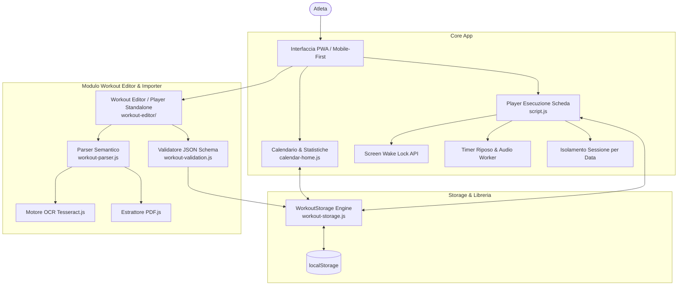

# Calisthenics Workout Tracker & Converter — Descrizione del Progetto

## 1. Visione e Obiettivo
**Calisthenics Workout Tracker** è una Progressive Web App (PWA) *offline-first* creata su misura per l'allenamento a corpo libero e calisthenics.

A differenza delle tradizionali app di fitness per sala pesi, l'applicativo è progettato attorno alle specifiche complessità metodologiche del calisthenics:
- **Calcolo automatico delle dipendenze tra esercizi** (es. serie calcolate in percentuale dal massimale appena eseguito: *Max/2 Prec*).
- **Gestione avanzata delle progressioni a salita e discesa (*Ladder*)** con contatori multipli e regole di recupero progressivo bloccato.
- **Supporto nativo per tenute isometriche, piramidali a gradini/gruppi e volumi tecnici distribuiti**.
- **Esperienza hands-free ed ergonomica sul campo**: schermo sempre attivo durante l'allenamento (*Screen Wake Lock API*), timer acustici e tattili ad alta precisione anche in background, azzeramento automatico per singola data di allenamento.
- **Sistema di acquisizione e conversione multi-formato**: convertitore integrato in grado di importare schede da testo libero, PDF o foto/screenshot tramite OCR neurale.

---

## 2. Architettura del Sistema

L'applicazione è sviluppata in architettura **Vanilla Web (HTML5, CSS3 moderno, JavaScript ES6+)**, garantendo:
1. **Zero latenza e avvio istantaneo**: nessun framework pesante (React/Angular/Vue) da scaricare o idratare.
2. **Funzionamento 100% Offline**: un Service Worker (`sw.js`) memorizza nella cache tutti gli asset dell'applicazione, inclusi i motori di parsing e i dizionari OCR.
3. **Persistenza locale reattiva**: nessun server esterno obbligatorio; tutti i dati (schede, cronologia calendario, sessioni attive e record) sono gestiti in modo sicuro e persistente nel browser tramite `localStorage`.



---

## 3. Metodi e Logiche di Allenamento Supportate

L'applicazione interpreta e gestisce nativamente **9 metodologie di allenamento**:

| Metodo (`tipo`) | Descrizione | Logica e Interazione |
| :--- | :--- | :--- |
| **`serie_reps`** | Serie × Ripetizioni costanti | Contatore decrementale/incrementale per le serie completate con feedback di completamento visivo. |
| **`serie_tenuta`** | Tenute isometriche a tempo (sec) | Mostra i secondi di tenuta (es. `5 x 20"`) e avvia il timer di tenuta dedicato con segnale acustico di fine esercizio. |
| **`max`** | Test Massimale di ripetizioni o secondi | Fornisce un campo di input numerico in cui registrare il record della sessione. |
| **`max_meta_prec`** | Metà del Massimale Precedente (*Max/2 Prec*) | Legge in tempo reale il valore inserito nell'esercizio `max` precedente, calcola `ceil(max / 2)` e aggiorna dinamicamente l'obiettivo del set. |
| **`ladder`** | Progressione a incremento (+1 rep per serie) con eventuale salita e discesa | Presenta **3 contatori simultanei**: *Reps da fare*, *Serie precedente*, *Reps totali*. Regola dinamica dei recuperi (30" a 1 rep, 60" a 2 rep, 90" da 3 rep in su sia in salita che in discesa). Pulsante per dichiarare il picco e iniziare la discesa simmetrica fino a 1 rep. |
| **`piramidale`** | Sequenza piramidale singola o a gruppi | Supporta sequenze dirette (es. `2-4-6-8-6-4-2`) e piramidi a gruppi (es. `4 x (3-5-7-5-3)` o `4 x 12-16-20`) con timer differenziati tra gradini e tra gruppi. |
| **`reps_totali`** | Volume tecnico complessivo distribuito | L'atleta deve accumulare un totale prefissato di ripetizioni (es. `30 reps tecniche`), scalabili serie per serie liberamente. |
| **`max_range`** | Massimali a serie variabili (es. 3-4 serie al max) | Gestione di intervalli di serie min/max per monitorare il volume a cedimento. |
| **`libero`** | Schema libero / personalizzato | Esercizi a corpo libero con note esplicative e recuperi personalizzabili. |

---

## 4. Schede Predefinite Integrate

L'applicazione include **6 schede complete** calibrate per cicli di spinta e tirata:

### Schede di Spinta (Push)
- **Spinta 1**: Piegamenti in verticale mani strette con dislivello ridotto (6x3) • Piegamenti verticale mani larghe (5x5) • Dip ladder incremento da 1 con salita e discesa • Piegamenti su rialzo 8 cm (1xMax) • Piegamenti a terra 5x Max/2 Prec • Barchetta (5x20").
- **Spinta 2**: Piegamenti in verticale (1xMax + 4xMax/2) • Dip (1xMax) • Piegamenti su rialzo 4 cm in piramidale a gruppi 4x(12-16-20-16-12) • Piegamenti a diamante (30 reps tecniche) • Tuck dragon flag (5x7).

### Schede di Tirata (Pull)
- **Tirata 1 (Volume)**: Trazioni prone alternate ROM/mezzo ROM ladder con discesa • Trazioni supine (30 reps) • Tuck Front Lever (4xMax) • Tuck Front Lever raise (4x Max/2 Prec) • Leg raise o Dragon flag (3-4 serie).
- **Tirata 2 (Volume)**: Trazioni prone con fermo 2" a metà (6x4) • Trazioni presa larga (2xMax) • Tuck Back Lever (3x20") • Australian pull up (2xMax) • Barchetta (4x20").
- **Tirata 3**: Chin up ladder 1 • Rematore australiano (30 reps) • Scapular pull up (3x10) • Front lever tuck (4x12") • Superman hold (3x30").
- **Tirata 4**: Trazioni neutre piramidali a gruppi 4x(3-5-7-5-3) con 20" tra gradini e 2'30" tra gruppi • Trazioni larghe (30 reps) • Rematore australiano rialzato (4x8) • Front lever raises (4x6) • Hollow rock (3x15).

---

## 5. Caratteristiche Funzionali Chiave

### A. Screen Wake Lock (Schermo Sempre Attivo)
Durante le sessioni di allenamento reale (quando l'utente è all'interno di una scheda o ha un timer in esecuzione), l'app sfrutta l'API nativa `navigator.wakeLock` per impedire lo spegnimento dello schermo del dispositivo. Appena si ritorna al menu o alla home, il Wake Lock viene rilasciato per salvaguardare la batteria. Se l'app perde visibilità e poi viene riaperta, il Wake Lock viene riagganciato in automatico tramite `visibilitychange`.

### B. Isolamento Sessioni per Data Calendario
I progressi (serie completate, massimali registrati, ripetizioni ladder) sono indicizzati per data attiva (`YYYY-MM-DD`). Questo garantisce che selezionando una nuova data dal calendario l'utente trovi la scheda **immediatamente pulita e azzerata**, senza residui dall'allenamento precedente e senza dover premere alcun tasto di reset manuale.

### C. Timer di Riposo ad Alta Precisione & Feedback Multimodale
- **Audio Web API & Countdown 3-2-1**: countdown acustico negli ultimi 3 secondi a tonalità crescente (700Hz, 820Hz, 940Hz) seguito dal trillo finale, con buffer audio silente in background per impedire all'OS di sospendere il processo del browser.
- **Pulsante Muto / Audio Rapido**: selettore (🔊 / 🔇) posizionato direttamente sulla testata del timer per silenziare o riattivare i suoni all'istante (memorizzato in `localStorage`).
- **Web Worker**: il decremento del tempo scorre in un thread separato (`timerWorker`) che non subisce il rallentamento del throttling dei browser mobile quando lo schermo è bloccato.
- **Feedback Tattile & Visivo "GO!"**: sequenze aptiche progressive (3, 2, 1) e triplo pattern finale, accompagnati dalla conferma visiva luminosa `GO! 💪` a fine recupero.
- **Animazione Tattile Serie**: effetto pop elastico al completamento delle serie per un feedback immediato e soddisfacente.

### D. Modulo Workout Editor & Importer Intelligente
- **Parser Semantico (`workout-parser.js`)**: estrae titolo, esercizi, recuperi, formati e note da qualsiasi testo non strutturato.
- **Correzione Errori OCR**: corregge scambi frequenti di caratteri (es. `18s` -> `10s`, `28s` -> `20s`, `nin` -> `min`).
- **Lettura PDF e Immagini**: parsing diretto di documenti PDF nativi con `pdf.js` ed elaborazione di foto/screenshot tramite `tesseract.js` con pre-elaborazione canvas (filtro luminanza monocromatica e verifica confidenza token numerici).
- **Interfaccia Editor Pulita e Focalizzata**: interfaccia snella e priva di salvataggi o elenchi a vista; apre direttamente la modalità di composizione e importazione `✏️ Editor / Import` (JSON/Testo/OCR/PDF) o la modalità `🏋️ Prova` per l'allenamento.

### E. Esperienza Atleta sul Campo & Dashboard Statistiche (Strada 1)
- **Diario e Feedback Sessione (RPE & Note)**: pannello integrato a fondo scheda per registrare lo sforzo percepito (scala RPE 6-10: Facile, Medio, Duro, Quasi Max, Cedimento) e note dettagliate su carichi/zavorre utilizzate, sensazioni o dolori articolari.
- **Timer On-The-Fly Tuner**: pulsanti rapidi `-15s` e `+30s` con colori differenziati per regolare al volo i secondi di recupero direttamente dall'overlay circolare senza passare dall'editor.
- **Report Allenamento Condivisibile**: generatore automatico di un report testuale formattato con emoji e risultati (esercizi completati, picchi ladder, massimali registrati, RPE, note) copiabile negli appunti con un solo tap per WhatsApp, Telegram o il Coach.
- **Integrazione Storico Calendario**: visualizzazione badge RPE e blocco citazione delle note dell'atleta nei dettagli della sessione del calendario, con pulsante per ricondividere il report in qualsiasi momento.
- **Dashboard Statistiche & Record Personali (PR)**: modulo a comparsa integrato nella home con riepilogo volumi settimanali (push/pull/custom), grafico a barre delle sessioni, conteggio streak consecutivo e classifica dei migliori record personali registrati.

### F. Gestione Schede & Editor Snellito (Strada 3)
- **Interfaccia Pulita Senza Salvataggi a Vista**: L'Editor Schede è stato ripulito da ogni pannello di libreria o schede salvate a vista in cima alla schermata; all'apertura atterra direttamente nella modalità `✏️ Editor / Import` con convertitore multi-formato, garantendo un'interfaccia minimale, sgombra e focalizzata sulla composizione.
- **Modalità Prova Immediata (`🏋️ Prova`)**: test immediato della scheda attiva direttamente nel Player integrato con contatori di serie, timer e calcolo automatico dei recuperi.
- **Calendario Pulito e Diretto**: visualizzazione pulita del mese con registrazione e consultazione delle sole sessioni effettivamente svolte. Il click su qualsiasi giorno non registrato imposta immediatamente la data di allenamento e porta alla selezione libera delle schede, senza pop-up o schede consigliate forzate.

---

## 6. Mappa dei Componenti e File del Progetto

```
Calisthenics - Copia/
├── index.html                   # Entry point PWA, struttura schermate e navigazione
├── style.css                    # Design system (tema dark, glassmorphism, responsive)
├── script.js                    # Controller applicativo, WakeLock, timer, player schede
├── calendar-home.js             # Gestore calendario, storico allenamenti e statistiche
├── sw.js                        # Service Worker PWA (cache offline-first)
├── manifest.json                # PWA Web App Manifest
├── icon-192.svg / icon-512.svg  # Icone vettoriali ad alta risoluzione
│
├── workout-editor/              # Modulo Standalone Editor & Converter
│   ├── index.html               # UI dell'editor / player interattivo
│   ├── styles.css               # Stili dell'editor, preview e controlli JSON
│   ├── app.js                   # Controller del modulo editor/player
│   ├── workout-parser.js        # Parser da testo naturale a JSON
│   ├── workout-validation.js    # Motore di validazione formale delle schede
│   ├── workout-storage.js       # Database localStorage, schede preset e cronologia
│   ├── training-methods-library.js # Catalogo definizioni dei 9 metodi di allenamento
│   ├── ocr-confidence.js        # Analisi euristica della qualità OCR
│   ├── workout.schema.json      # JSON Schema formale (Draft-07)
│   └── workout-template.json    # Modello di partenza per nuove schede
```
