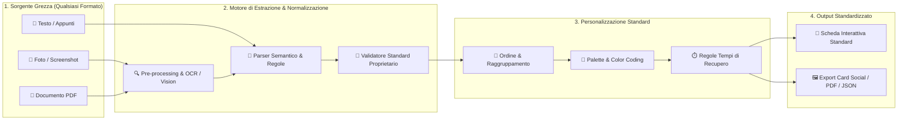

# Roadmap Strategica: Workout Standardizer & Editor Standalone

## 1. Visione del Prodotto
Trasformare l'attuale modulo **Workout Editor** da semplice strumento interno al tracker a una **"Macchina Universale di Standardizzazione Schede"** (*Workout Compiler & Standardizer*) e, in seguito, in un'**applicazione autonoma con un proprio ecosistema**.

### Il Problema che Risolve
Chiunque si alleni riceve o scrive schede nei formati più caotici:
- Foto di fogli di carta stropicciati o lavagne in palestra.
- Screenshot di chat WhatsApp, note del telefono o messaggi del coach.
- File PDF impaginati male, tabelle Excel o documenti Word non interattivi.
- Testi scritti con abbreviazioni incoerenti (`4x8`, `4 serie da 8`, `rec 1'30"`, `pausa 90s`).

### La Soluzione (Il Tuo Standard)
Un motore capace di **ingerire qualsiasi input** (foto, immagine, PDF, testo grezzo) e **compilarlo automaticamente** in una scheda digitale (e stampabile/esportabile) **rigorosamente standardizzata** secondo il tuo formato proprietario:
- **Ordine strutturato** (gerarchia esercizi, blocchi, serie, target, note).
- **Codifica cromatica intelligente** (colori distintivi per categoria: Spinta, Tirata, Gambe, Core, Skill, o personalizzabili dall'utente).
- **Tempi di recupero normalizzati** (convertiti in secondi esatti e formattati con badge chiari e timer pronti all'uso).
- **Metodologie codificate** (Ladder, Piramidali, Isometrie, Massimali, Serie×Reps, ecc.).

---

## 2. Architettura del Flusso ("La Macchina di Conversione")

---

## 3. Fasi della Roadmap (Le 5 Fasi di Sviluppo)

### Fase 1: Potenziamento del Motore di Acquisizione Universale (Input Engine)
*Obiettivo: Fare in modo che il software capisca qualsiasi foto o testo, anche scritto male.*
- **1.1 Pre-processing Immagine Avanzato**:
  - Ritaglio automatico dei bordi, raddrizzamento prospettico (deskew), aumento del contrasto adattivo per foto scattate al buio in palestra.
- **1.2 Doppia Pipeline di Lettura (Offline + AI Vision)**:
  - **Livello Locale (Tesseract OCR ottimizzato)**: dizionario sportivo dedicato (termini calisthenics, pesistica, abbreviazioni italiane e inglesi).
  - **Livello Vision AI (Opzionale / Locale via Ollama o Cloud API)**: lettura diretta multimodale dell'immagine per riconoscere tabelle complesse, frecce, circuiti e scrittura a mano.
- **1.3 Tolleranza Totale ai Formati Testuali**:
  - Riconoscimento di elenchi puntati, numerati, messaggi copiati da WhatsApp/Telegram senza punteggiatura, tabelle multi-colonna.

---

### Fase 2: Il "Compilatore" e lo Standard Proprietario (Core Standardizer)
*Obiettivo: Imporre il tuo standard qualitativo, visivo e strutturale su ogni scheda generata.*
- **2.1 Normalizzazione Automatica dei Nomi e dei Metodi**:
  - Unificazione delle varianti di scrittura (es. `"1 min e mezzo"`, `"1'30"`, `"1.30"`, `"90 sec"` diventano tutti `90s` -> badge standard `1' 30"`).
  - Riconoscimento automatico della metodologia (se vede `1-2-3-4-3-2-1` assegna automaticamente `piramidale`; se vede `+1 rep a salire` assegna `ladder`).
- **2.2 Motore di Ordinamento Intelligente**:
  - Possibilità di mantenere l'ordine originale oppure applicare l'**Ordine Standard** (es. *1. Skill / Isometrie -> 2. Fondamentali Multiarticolari / Massimali -> 3. Complementari a Volume -> 4. Core / Condizionamento*).
  - Riordino rapido drag-and-drop post-estrazione.
- **2.3 Regole di Default per Dati Mancanti**:
  - Se nella foto dell'utente manca il recupero su un esercizio, il motore può applicare una regola intelligente basata sul metodo (es. `90s` di default su serie_reps, `120s` a fine esercizio) segnalandolo all'utente.

---

### Fase 3: Sistema di Colori, Temi e Regole Utente (Visual Identity)
*Obiettivo: Dare all'utente il controllo su colori, ordine e recuperi, restando dentro la griglia estetica del tuo standard.*
- **3.1 Color Coding Semantico o Personalizzato**:
  - **Automatico per Categoria**: Giallo/Lime per Spinta, Blu/Ciano per Tirata, Rosso/Arancio per Gambe, Viola per Skill, Verde per Core.
  - **Automatico per Intensità/Metodo**: colori dei badge che distinguono immediatamente un esercizio `Max` da un `Ladder` o da una `Tenuta Isometrica`.
  - **Temi Utente / Coach**: possibilità di scegliere la palette della scheda manteniendo inalterato il layout e la tipografia proprietaria.
- **3.2 Gestione Globale dei Recuperi**:
  - Pannello rapido per applicare o scalare i tempi di recupero su tutta la scheda con un click (es. *"Imposta tutti i recuperi tra serie a 1'30" e tra esercizi a 2'00""*).

---

### Fase 4: Esportazione Multi-Canale & Condivisione (Output Engine)
*Obiettivo: Permettere a chiunque di usare o condividere la scheda standardizzata ovunque.*
- **4.1 Generazione Card Visiva (Immagine / PNG / Storia Instagram)**:
  - Esportazione della scheda standardizzata come immagine ad alta risoluzione con il tuo design distintivo (pronta da salvare in galleria o condividere).
- **4.2 Esportazione PDF Standardizzato**:
  - Generazione di un PDF pulito, scuro o chiaro, impaginato secondo il tuo standard grafico per chi vuole conservarlo o stamparlo.
- **4.3 Formato `.workout` / JSON & Link Diretto / QR Code**:
  - Esportazione del file dati standard o generazione di un QR Code che, se inquadrato da un altro utente, apre immediatamente la scheda interattiva.

---

### Fase 5: Distacco e Nascita dell'App Standalone & Ecosistema
*Obiettivo: Separare l'Editor dal Tracker di allenamento e renderlo un prodotto indipendente.*
- **5.1 Separazione Architetturale (Core SDK)**:
  - Isolamento di `workout-parser`, `workout-validation`, `workout-schema` e del motore grafico di rendering in un pacchetto indipendente.
- **5.2 App Standalone "Workout Standardizer"**:
  - Interfaccia focalizzata al 100% sul flusso in 3 step:
    1. **Carica** (Foto, Screenshot, PDF, Testo)
    2. **Personalizza nel tuo Standard** (Ordine, Colori, Recuperi)
    3. **Ottieni la Scheda** (Usa interattivamente, Esporta Immagine/PDF/Link)
- **5.3 Ecosistema & Integrazione**:
  - L'app standalone genera schede con il tuo standard universale.
  - Il **Calisthenics Workout Tracker** (e qualsiasi altra app futura del tuo ecosistema) diventa un "lettore/player" compatibile al 100% che importa con un click le schede generate dallo Standardizer.

---

## 4. Tabella di Marcia Consigliata (Priorità Immediate)

| Step | Intervento | Stato | Impatto |
| :--- | :--- | :--- | :--- |
| **Step 1** | **Definizione dei Profili Colore & Categorie** nello schema JSON (`colore`, `categoria`, `ordine`) | Da iniziare | Permette di codificare visivamente qualsiasi scheda in base alle preferenze utente. |
| **Step 2** | **Barra di Controllo Standardizzazione Rapida** nell'Editor (Selettore colore scheda, applicazione rapida recuperi, riordino blocchi) | Da iniziare | Trasforma l'editor da semplice testo/JSON a vero configuratore standardizzato. |
| **Step 3** | **Potenziamento OCR & Parser** su foto reali di schede scritte a mano o screenshot | In corso (Base 94%) | Rende la "macchina" infallibile sugli input sporchi degli utenti. |
| **Step 4** | **Esportatore Visivo (PNG / PDF Standard)** della scheda generata | Da iniziare | Crea l'effetto "wow" e rende il tuo standard riconoscibile fuori dall'app. |
| **Step 5** | **Packaging come App Standalone** separata dal Tracker | Futuro | Lancia il prodotto autonomo con il proprio ecosistema. |
